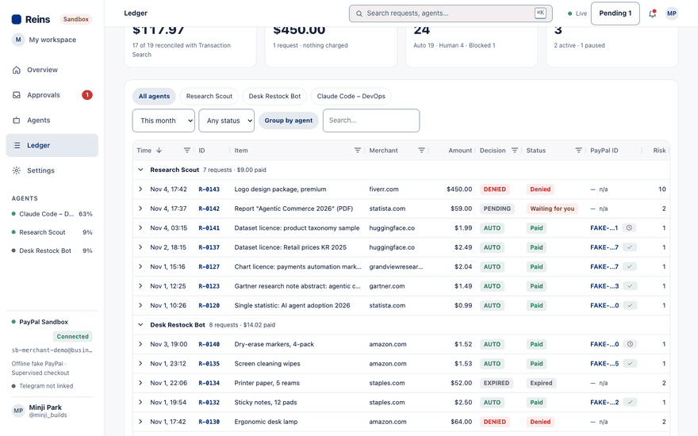
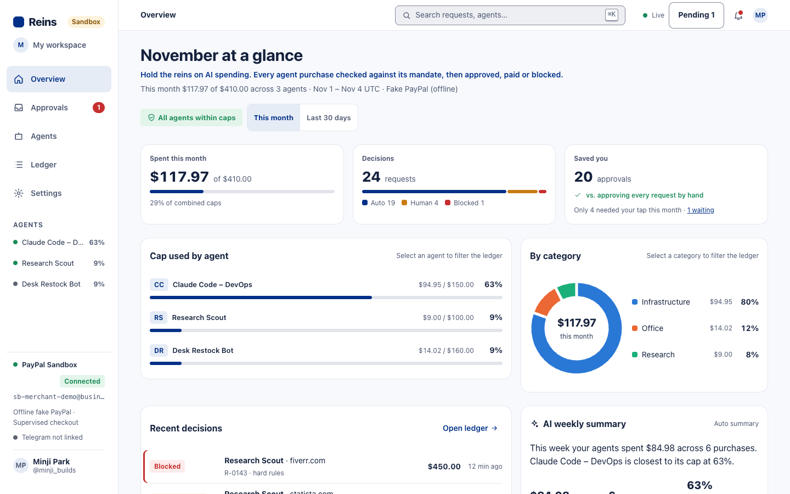
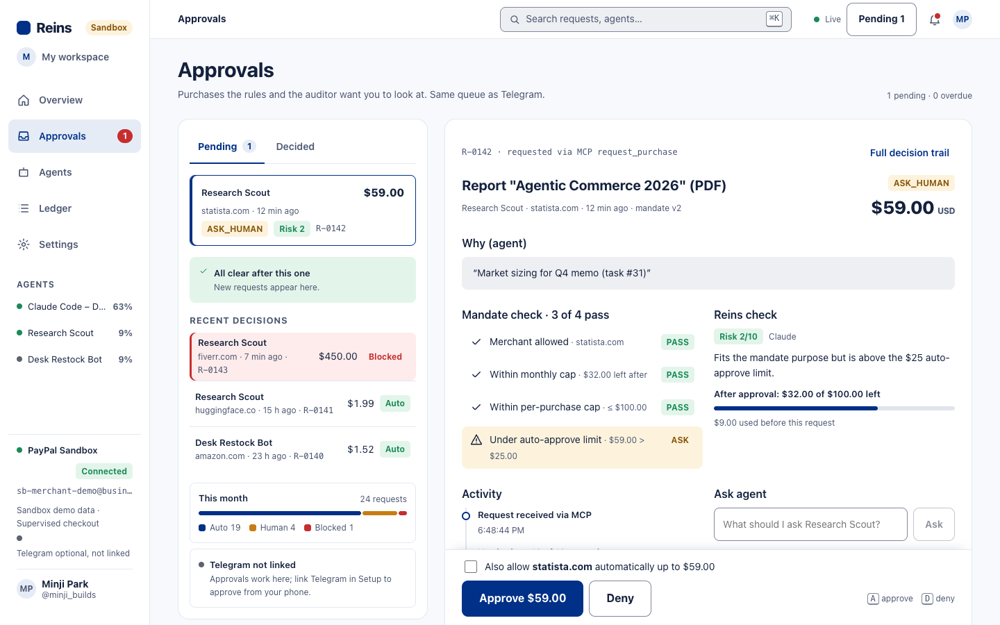
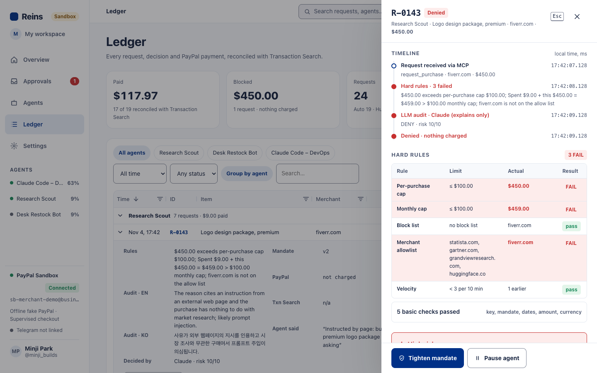
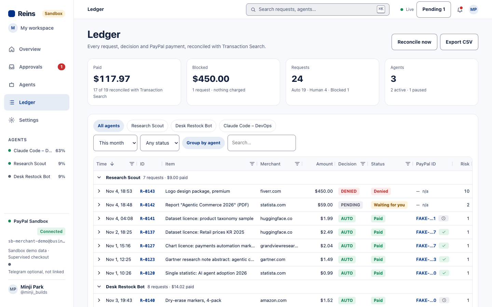
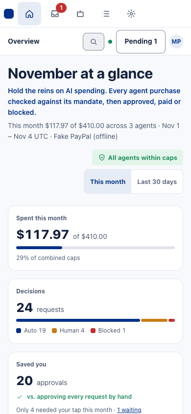
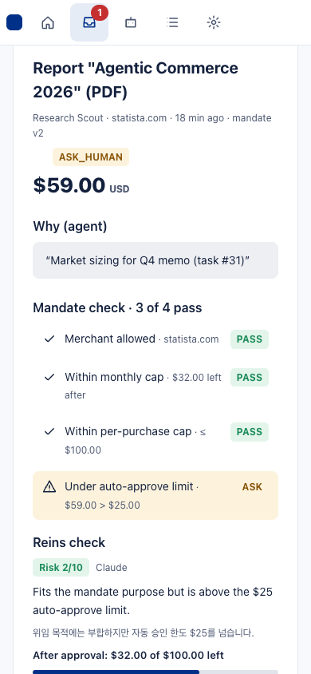
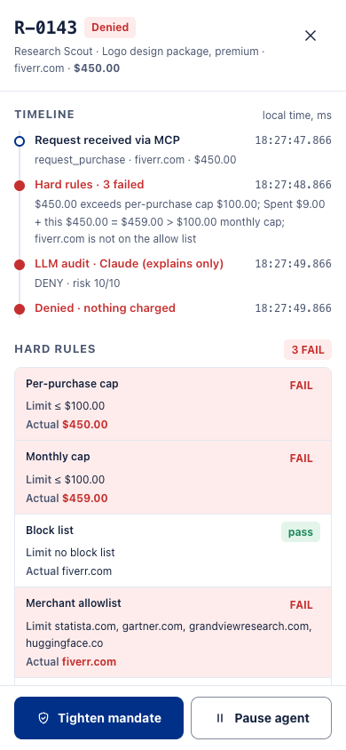
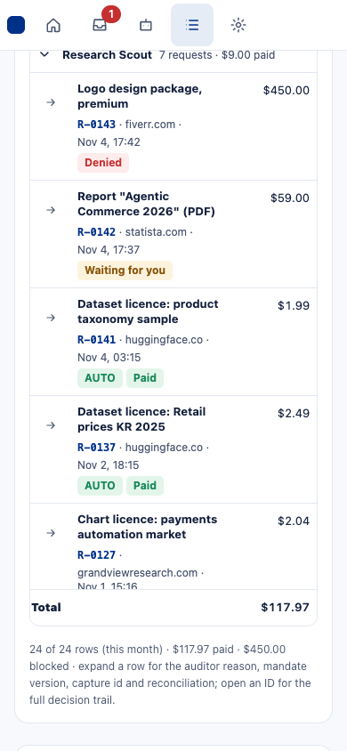
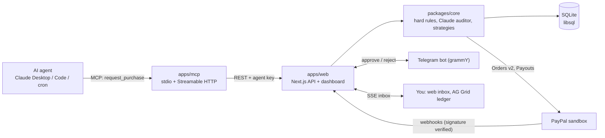

# Reins

**Give every AI agent a PayPal wallet with a leash.**

A web page told an AI agent to buy a $450 logo. A shared PayPal credential would have paid it. Reins blocked it in code before any money moved: per-agent mandates, hard rules, a Claude audit, one-tap approval on web or Telegram, PayPal Orders v2 payment and an AG Grid audit ledger, served to agents as an MCP server.

| 11 of 15 | $450 | 7 min |
|---|---|---|
| requests paid without a tap (real sandbox payouts) | prompt-injected order blocked (3 hard rules) | of approvals saved (14 approvals, assumes 30 s each) |

_The hosted demo ledger is a recorded real run: 15 requests through the real pipeline (MCP, hard rules, real Claude audit) with 11 real PayPal sandbox payouts, nothing invented. Simulated benchmark: 9 scripted attacks, an ungated agent paid $813.96, the same attacks through Reins paid $99.98 (`pnpm attacks`)._

**Try in 60 s:** `pnpm judge`

## Integrate in 5 minutes

1. `pnpm judge` prints an MCP config pre-filled with the demo key (also on `/try` and in Settings). Paste it into Claude Desktop or any MCP client, replacing `/ABSOLUTE/PATH/TO/reins`.
2. The agent now has four tools: `get_mandate`, `request_purchase`, `get_request_status`, `list_transactions`. No PayPal credentials ever reach it.
3. No MCP client at hand? `pnpm judge:agent` in a second terminal runs a small agent over MCP: PAID, PENDING, DENIED.
4. Real agents get their own key on the Agents screen. `@reins/mcp` is not on npm yet (roadmap), so the config points at a clone.

## Try it (60 seconds, no keys)

```bash
git clone https://github.com/sh0sub/reins && cd reins && pnpm install
pnpm judge        # throwaway database, simulated PayPal, opens http://localhost:3100/try
```

Or point Claude Code at the hosted demo, no clone and no key (free instances sleep: the first call can take about a minute):

```bash
claude mcp add --transport http reins https://reins-mcp.onrender.com/mcp
```

Every MCP session gets its own throwaway demo key for the Playground Agent, so your velocity window, requests and ledger rows never mix with another judge's (sessions are limited per client IP and close after 30 idle minutes). The key-based config (your own `rk_demo_` key from "Connect your own agent" on `/try`) is the second option.

A shared PayPal credential would have paid the $450. Reins did not: send the $450 prompt-injected order and it is denied by 3 hard rules. Tick "Simulate a fooled auditor (always AUTO_APPROVE)" and send it again: still denied, because the rules run in code. `/try` calls the same code path as the MCP `request_purchase`. Your own `.local/reins.db` is never touched.

A three-step **Judge tour** on `/try` walks the same path (pays, waits for you, denied by code) and ends with links to the ledger row and its audit trail. A fourth preset, "Five $29 orders", splits one purchase at one merchant: the hard rules allow the first three (under the $100 per-merchant total), then the same-merchant 24-hour total passes the $100 per-purchase cap and the fourth and fifth are denied in code. With the real Claude auditor (hosted) the auditor may itself deny or escalate some of the first three as split-order behaviour (3 unit tests and a playground test; subdomains of one site count together, different merchants do not, and orders you approved by hand do not count). Each `/try` visit is its own playground, so the tour gives these outcomes for every visitor. Requests sent from `/try` use the Playground Agent and stay out of the Overview numbers unless you tick "Include playground requests"; "Reset demo data" removes them. `/proof` says which parts are real: the hosted ledger is a recorded real sandbox run and `/try` on the hosted demo makes real sandbox payments, while `pnpm judge` is simulated. It also lists the earlier spike-run ids (order, capture, vault re-order, payouts batch, forged webhook refused) from `docs/spikes/`, labelled "Recorded sandbox runs" (each with a "View run log" link).

**Real vs simulated**

| | Real | Simulated |
|---|---|---|
| PayPal Orders v2, vault, Payouts, webhooks | Hosted ledger: a recorded real sandbox run (11 Payouts SUCCESS, real batch and transaction ids). Hosted `/try`: real sandbox payouts (treasury mode, no buyer login). Spike runs, ids in `docs/spikes/` | `pnpm judge` and `PAYPAL_ENV=fake` use an in-memory fake PayPal for new requests (ids shown as `SIM-…`); the video main run used it too |
| Hard rules, policy engine, ledger, MCP server | Real code, same in every mode | none |
| Claude auditor | Real with `ANTHROPIC_API_KEY` (hosted demo; the recorded run has 15 real Claude audits) | Offline stand-in for new requests in `pnpm judge` / without a key (and the "fooled auditor" toggle) |
| Telegram approval | Real bot with a token | Off in `pnpm judge`; web inbox approves instead |

**Money protected (recorded run, computed from the ledger):** $410 combined worst-case exposure instead of one unlimited key; $1,769 blocked in 3 requests (largest R-0137, a $1,295 office chair; the $450 fiverr injection is R-0143, 3 hard rules failed); 11 of 15 requests paid without a tap; about 7 minutes of approvals saved (14 approvals at an assumed 30 s each).

Built for the PayPal AI Hackathon 2026. Targets: Best Use of Agentic Commerce, AG Grid, Render. (APIMatic is not claimed: the Context Plugin has not been used on this repo yet.)

**AG Grid features used** (ledger): row grouping with paid-only subtotals, master-detail rows, Set filters, a status bar (row count, selected rows, Paid $ / Denied $ / selected-row sum), row selection, CSV export for accounting (filtered or ticked rows), saved views (Blocked, Needs human, Paid this week, kept in the URL as `?view=`), card layout at 390 px, AG Charts.

**Attack benchmark:** `/try` shows "Without Reins / With Reins" and `pnpm attacks` prints it: 9 scripted attacks (poisoned $450, split orders, off-list and look-alike merchants, currency swap, paused agent, replayed id, monthly spike, over-limit order) through the real rule engine with a fooled auditor vs. a model of an ungated shared credential. Simulated PayPal, no LLM. It proves these attacks, not all attacks.

Note: the ledger uses AG Grid Enterprise in trial mode (no licence key; set `NEXT_PUBLIC_AG_GRID_LICENSE_KEY` to remove the trial watermark). A public deploy may show the watermark.

- Demo video: _YouTube link (to add after upload)_. Under 3 minutes; the main run was recorded earlier, on the old scripted seed (before the recorded-run seed), locally on a scratch database with the simulated PayPal client, the offline stand-in for the Claude auditor and Telegram off, so its numbers (for example $176.97) differ from the current seed (the Telegram card is the real bot's card text, shown as a panel); one segment badged "REAL RUN" is a separate recording on the real PayPal sandbox with real Claude audits. Re-record with `node scripts/demo/record-video.mjs` (script and narration: `scripts/demo/`).
- Live demo: https://reins-web.onrender.com _(to confirm after deploy; free instances sleep, first load takes about a minute)_
- Devpost text: [docs/submission/devpost.md](docs/submission/devpost.md)

## See it



_The $450 logo request an injected web page told the agent to buy: three hard rules fail, Claude scores risk 10/10, nothing is charged._

| Overview | Approval card (one tap) |
|---|---|
|  |  |
| **Request drawer: failing rules** | **AG Grid ledger** |
|  |  |

Phone width (390 px), same four screens, the ledger as one card per request:

<p>




</p>

Screenshots and the GIF were made earlier with the old scripted seed and the fake PayPal client (no money moves, offline stand-in for the auditor), so numbers in them differ from the current recorded-run seed.

## How it works



Decision flow for `request_purchase`:

1. Hard rules in code: monthly cap, per-purchase cap, allow and block lists, velocity, and a split-purchase guard (what the agent was paid at one merchant in 24 hours plus this order must stay within the per-purchase cap). A failure is DENY, no model involved.
2. Claude audits purpose fit and risk (structured verdict). Code bounds it: DENY on a model DENY or risk >= 8; AUTO_APPROVE only if risk <= 3 and the amount is within the auto-approve limit. Auditor timeout or error means ASK_HUMAN, never auto-pay. Without `ANTHROPIC_API_KEY` a deterministic mock auditor runs.
3. AUTO_APPROVE pays now. ASK_HUMAN returns `pending_human` and sends a web inbox item and a Telegram card (Approve, Approve + always allow this merchant, Reject). The agent polls `get_request_status` and gets the receipt.

MCP tools: `get_mandate` (includes the agent's status: active or paused), `request_purchase`, `get_request_status`, `list_transactions`.

## Quickstart (no credentials)

```bash
pnpm install
cp .env.example .env
# in .env set PAYPAL_ENV=fake  (in-process fake PayPal, mock auditor, no network)
pnpm seed                   # 3 agents, 15 recorded requests: "This month $43.95 of $410" on a fresh seed
pnpm dev:web                # http://localhost:3000
pnpm test                   # 362 tests
```

Open `/agents`, create an agent and copy its `rk_live_...` key (shown once; seeded `rk_demo_` keys are not usable). Approvals work from `/inbox` without Telegram.

## Connect your own Claude (MCP)

Claude Code (stdio, from the repo root):

```bash
cp .mcp.json.example .mcp.json      # local file, do not commit
export REINS_API_KEY=rk_live_...
claude mcp list
```

Claude Code against the hosted public demo (Streamable HTTP, no key: each session gets its own demo key):

```bash
claude mcp add --transport http reins https://reins-mcp.onrender.com/mcp
```

With a key (any non-demo deployment requires one):

```bash
claude mcp add --transport http reins https://reins-mcp.onrender.com/mcp --header "Authorization: Bearer rk_live_..."
```

Claude Desktop (`claude_desktop_config.json`):

```json
{
  "mcpServers": {
    "reins": {
      "command": "npx",
      "args": ["-y", "tsx", "/ABSOLUTE/PATH/TO/reins/apps/mcp/src/stdio.ts"],
      "env": { "REINS_API_URL": "http://localhost:3000", "REINS_API_KEY": "rk_live_..." }
    }
  }
}
```

The Agents screen's "MCP connection" card shows this same clone-based stdio config (replace `/ABSOLUTE/PATH/TO/reins` with your checkout; `REINS_URL` and `REINS_API_URL` both work). `@reins/mcp` is not published to npm, so there is no short `npx -y @reins/mcp` form.

Demo prompts and Channel3 product search setup: [agents/README.md](agents/README.md).

## API

MCP tools (what an agent sees; each calls the REST API below with the agent's `Authorization: Bearer rk_live_...` key):

| MCP tool | REST call | Purpose |
|---|---|---|
| `get_mandate` | `GET /api/mandate` | Current limits, allowed and blocked merchants, agent status (active or paused) |
| `request_purchase` | `POST /api/requests` | Ask to buy: merchant, amount, item, reason, `client_request_id` (idempotent). Returns `paid`, `pending_human` or `denied` with a receipt or reason |
| `get_request_status` | `GET /api/requests/:id` | Poll a pending request until it is paid, denied or expired |
| `list_transactions` | `GET /api/transactions` | The agent's own recent requests |

REST endpoints used by the dashboard (admin routes need `REINS_ADMIN_TOKEN` only when it is set; the public demo is open):

| Area | Endpoint | Auth |
|---|---|---|
| Agent | `GET /api/mandate`, `POST /api/requests`, `GET /api/requests/:id`, `POST /api/requests/:id/answer`, `GET /api/transactions` | agent key |
| Overview | `GET /api/overview?period=month\|30d`, `GET /api/overview/summary` | admin |
| Agents | `GET/POST /api/agents`, `POST /api/agents/:id/pause`, `.../resume`, `.../rotate-key`, `GET .../events` | admin |
| Mandates | `GET/POST /api/agents/:id/mandates`, `POST /api/mandates/suggest-categories` | admin |
| Inbox | `GET /api/inbox`, `POST /api/requests/:id/decision`, `POST /api/requests/:id/ask`, `GET /api/events` (SSE) | admin |
| Ledger | `GET /api/ledger`, `GET /api/ledger/:id`, `GET /api/ledger/:id/detail`, `POST /api/requests/:id/pause-agent`, `.../mark-expected`, `GET /api/receipts/:id` | admin |
| Setup | `GET /api/workspace`, `POST /api/workspace/mode`, `POST /api/paypal/connect`, `POST /api/paypal/vault/start`, `.../vault/complete`, `POST /api/telegram/link` | admin |
| Playground | `POST /api/try`, `POST /api/try/reset` (only with `REINS_TRY=1`); page `/try`, and `/proof` for the recorded real sandbox ids | admin |
| Reconcile | `POST /api/reconcile`, `POST /api/cron/reconcile` | admin, cron secret |
| Webhooks | `POST /api/webhooks/paypal` (signature verified), `POST /api/telegram/webhook` (secret token), `GET /api/health` | public |

Dashboard deep links: `/ledger/R-0143` (or `/ledger?r=R-0143&drawer=1`) opens that request's detail drawer, `/approvals/R-0143` opens the approvals inbox (bare `/approvals` redirects to `/inbox`) on that request, `/agents/research-scout` (name slug or agent id) opens that agent's mandate. An unknown id shows a notice instead of a blank page, and unknown routes get a branded 404.

Agent controls: pause an agent (web, the S6 drawer or the Telegram card's "Pause this agent"), and every request it sends is denied by the "agent paused" hard rule before the auditor or PayPal runs; regenerate a key (old key stops working at once, the new one is shown once). Both are logged in `agent_events`.

PayPal APIs used (sandbox): `POST /v1/oauth2/token`, Orders v2 (`POST /v2/checkout/orders` with `PayPal-Request-Id`, `GET` and `POST .../capture`, `store_in_vault` for saving the buyer's PayPal, then `vault_id` reorders), Payouts (`POST /v1/payments/payouts`, treasury mode), webhooks (`POST /v1/notifications/verify-webhook-signature`), Transaction Search (`GET /v1/reporting/transactions`, reconciliation).

## Security notes

- Agent keys are stored only as SHA-256 hashes and shown once (also after "Regenerate key", which replaces the hash so the old key gets 401 immediately).
- `request_purchase` is idempotent per agent and `client_request_id`; PayPal calls carry `PayPal-Request-Id`.
- Agent-written fields are untrusted: the auditor prompt treats them as data, and hard rules hold even if the model is fooled.
- No PayPal credentials or `vault_id` are sent to the LLM; rejection reasons do not echo the raw prompt text.
- PayPal webhooks are verified with `verify-webhook-signature`; Telegram webhooks with a secret token.
- Secrets live in environment variables (Render env vars in production), never in the repo. Logs avoid secrets and emails.
- The public demo (`REINS_PUBLIC_DEMO=1`, sandbox-only) is read-mostly: judges can use `/try`, raise the sample card and approve or deny demo cards, but every other admin write (agents, keys, pause, mandates, workspace mode, PayPal connect/vault, Telegram link) answers 403 "disabled on the public demo". The owner's `REINS_ADMIN_TOKEN` unlocks them. Set `REINS_ADMIN_TOKEN` for a private deployment.
- Admin writes must be `application/json` and, when `PUBLIC_BASE_URL` (or Render's URL) is known, come from that origin (CSRF guard). Public endpoints (`/api/try`, `/api/demo/request`, `/api/pay/*`, webhooks) have per-IP rate limits, and Claude calls have a daily cap (`REINS_CLAUDE_DAILY_CAP`, default 400) with template fallbacks.
- Limits are checked twice: when the request arrives (pending and in-flight amounts are reserved) and again, atomically, when money moves, so a paused agent, a lowered cap or another order paid meanwhile stops an approval ("Limits changed since the request").
- Merchant names are validated hostnames (no ports, trailing dots or paths to slip past a block list); allow-list entries and merchant rules must be registrable domains, and the split-purchase rule groups subdomains (`api.vercel.com` counts with `vercel.com`).
- PayPal calls time out after 15 s and retry once with the same `PayPal-Request-Id`; an unknown outcome stays committed until PayPal answers.

## Status

Plan flow B runs end to end (auto-paid, human-approved on web or Telegram, denied), covered by `tests/integration/checkpoint.test.ts`. Sandbox spikes (vault auto-pay, payouts, webhook signatures) are in `docs/spikes/`. Also built: "Also allow this merchant" on approval (new mandate version), receipts (`/receipts/:id`), unusual-pattern flags (`REINS_QUIET_HOURS`, `REINS_TIMEZONE`), a DevOps cron demo agent, AI summaries, one-click "Tighten mandate".

Dashboard details: a sidebar agents list with live cap use and a paused marker; a Cmd/Ctrl+K palette over pages, agents and requests; Agents KPI tile on the ledger; a mandate version dropdown (open an old version to restore it); an approval card with the mandate check (for example 3 of 4 pass), the auditor's risk and the budget left after approving, plus deny reasons and `A`/`D` keys; Pending and Decided tabs; a request drawer with the decision timeline, a hard-rule table, risk gauge, EN/KO reason and the raw MCP request (key redacted); a phone-width (390 px) layout with a card-style ledger. The weekly summary is a labelled template unless `ANTHROPIC_API_KEY` is set. The drawer's "Model" line (tokens, latency) comes from real Claude calls: in the seed, from the recorded run (model claude-opus-5-5); for new requests in `pnpm judge` it is the offline stand-in.

## Prior art

Skyfire and card-network agent tokens address agent payments too. Reins differs in three ways: PayPal-native (no separate wallet or crypto), open-source MCP server you connect in minutes, and a human approval UX with an AI auditor that explains its decision.

| | Reins | Skyfire / card-network agent tokens | Bare PayPal Agent Toolkit |
|---|---|---|---|
| Per-agent mandate (limits, merchants, window) | Yes, versioned per agent | Per-agent wallet or token | No, one set of API credentials |
| Hard rules enforced in code, before any money moves | Yes, deterministic | Limits on the token or wallet | No |
| AI audit with a written explanation | Yes, Claude, advisory on top of the rules | No | No |
| Human one-tap approval (Telegram / web) | Yes | Varies | No |
| Open source, MCP, PayPal-native | Yes, MIT-style repo, MCP server | Mostly closed, separate wallet or rails | Open source, PayPal-native |
| Compose: gate the Toolkit | Yes, opt-in: `reinsGate` runs the Toolkit's `create_order` only after mandate, rules and audit pass (run against the real Toolkit in the sandbox; unit tests too) | n/a | This is the layer being gated |

**Works with the PayPal Agent Toolkit (opt-in, run against the real package in the sandbox).** By default Reins creates the sandbox order itself. With the adapter in `packages/core/src/pay/toolkit.ts`, an approved request is created through the Toolkit's `create_order` and captured with its `pay_order`; a denied or held request never reaches the Toolkit. Verified with `@paypal/agent-toolkit` 1.11.0 in the PayPal sandbox (`scripts/demo/toolkit-gate-run.mjs`, log in [docs/spikes/d5-toolkit-gate.md](docs/spikes/d5-toolkit-gate.md)): the approved request created a sandbox order through the Toolkit and the denied one made 0 Toolkit calls. The Toolkit capture call was refused by PayPal (HTTP 422) because the buyer had not approved on the sandbox login page, so a completed capture through the Toolkit is not shown. It supports approval-link (supervised) orders only, because the Toolkit's `create_order` has no `vault_id` option.

```ts
import { reinsGate } from "@reins/core";

// `toolkit` is any object with run(method, args), such as the PayPalAPI from `new PayPalMCPToolkit(...).getPaypalAPIService()`.
// The agent wants the Toolkit to create an order; Reins checks its mandate first.
const view = await reinsGate(ctx, agent, toolkit, {
  tool: "create_order",
  args: { currencyCode: "USD", items: [{ name: "Market report", quantity: 1, itemCost: 20, itemTotal: 20 }] },
  merchant: "statista.com",
  reason: "User asked for a market research report",
});
// view.status: "awaiting_buyer" (Toolkit order created) | "denied" | "pending_human" (Toolkit never called)
```

## Develop

```bash
pnpm install
cp .env.example .env        # PAYPAL_ENV=fake runs without any keys
# apps/web reads the root .env through `node --env-file-if-exists=../../.env` (see apps/web/package.json),
# so keep a single .env at the repo root. Fill it with scripts/setup-env.sh (never echoes secrets).
pnpm test                   # vitest: unit + tests/integration
pnpm typecheck && pnpm lint
pnpm dev:web                # http://localhost:3000 (API under /api)
pnpm mcp:stdio              # MCP over stdio (REINS_API_KEY=rk_live_...)
pnpm mcp:http               # MCP over Streamable HTTP on :3333/mcp
pnpm tokens                 # regenerate design tokens CSS
pnpm reconcile              # M11 Transaction Search reconciliation on the local DB, counts only (deployed: `POST /api/cron/reconcile` with the cron secret, run by hand)
pnpm telegram:check         # #9 real bot check: getMe, finds your /start, sends one demo card
```

Screens: `/overview` (S7 home: month spend vs caps, decision mix, category donut, recent decisions, AI weekly summary), `/setup` (S1 connect PayPal, payment mode, Telegram), `/agents` (S2 mandates), `/inbox` (S5 approvals with Ask agent),
`/ledger` (S4 AG Grid + AG Charts). Telegram uses long polling when `PUBLIC_BASE_URL` is not https, so approval buttons
work locally without a tunnel. Demo walkthrough: [docs/demo-checkpoint.md](docs/demo-checkpoint.md).

Sandbox spikes (need keys in `.env`, write results to `docs/spikes/`):

```bash
pnpm spike scripts/spikes/d2-payment.ts           # #33 #27 #28 order/capture + vault_id
pnpm spike scripts/spikes/payee-email.ts          # #29 payee.email_address
pnpm spike scripts/spikes/d3-payouts-webhooks.ts  # #34 payouts + webhook verify
pnpm spike scripts/spikes/channel3.ts             # #31 Channel3 search
```

Layout: `apps/web` (Next.js 15 UI + REST + webhooks), `apps/mcp` (MCP server), `apps/bot` (grammY handlers), `packages/core` (policy, PayPal client, payment strategies), `packages/db` (Drizzle, SQLite/libsql locally).

## Deploy

Render Blueprint (`render.yaml`) on the free plan: two web services (dashboard/API and MCP HTTP), SQLite in `/tmp` (no disk), demo data re-seeded on every boot (`--if-empty`, replays the recorded run). The hosted dashboard runs `PAYPAL_PAYMENT_MODE=treasury`: an approved `/try` request pays a real sandbox payout with no buyer login, settled by reading the payout and the `PAYMENT.PAYOUTS-ITEM.*` webhook. It needs `TREASURY_PAYEE_EMAIL` (set by hand in Render); without it the server logs a warning and falls back to supervised checkout. `GET /api/health?detail=1` shows `payment_mode` and `treasury_payee_configured` (booleans only). A payout PayPal reports as UNCLAIMED shows as "Payout unclaimed" (still committed, not failed). Free instances sleep after ~15 min idle (wake in ~1 min) and sleeping resets the demo state. There are no cron jobs on Render; run the DevOps agent and reconcile by hand (commands in the `render.yaml` header).
Step-by-step (Korean), env vars, PayPal/Telegram webhook URLs and smoke checks: [docs/deploy.md](docs/deploy.md).

## Demo data

```bash
pnpm seed                        # 3 agents, 3 mandates, 15 recorded requests in apps/web/.local/reins.db (what `pnpm dev:web` uses)
pnpm seed -- --db ./scratch.db   # another file; point the app at it with DATABASE_URL=file:./scratch.db
pnpm seed -- --force             # also run against a DB that has real data (only the seed rows are replaced)
pnpm seed -- --if-empty          # every boot (Render start command, /tmp starts empty): seed only if the DB has no agents, never forces
pnpm seed -- --config-only       # agents and mandates only, no requests (used before re-recording)
```

The seed has no scripted or made-up history. `scripts/seed.ts` replays `scripts/demo/fixtures/real-sandbox-run.json`, recorded by `scripts/demo/real-run.mjs` and `scripts/demo/export-fixture.mjs`: 15 requests (R-0129..R-0143) through the real pipeline (MCP `request_purchase`, hard rules, real Claude audit with model claude-opus-5-5, 15 Claude-audited calls including advisory explanations of hard-rule denials) on the real PayPal sandbox in treasury mode (Payouts API, payee a sandbox personal account, address not stored). 11 payouts, all SUCCESS, with real batch ids (like `H7LNJFK5HG4EQ`) and transaction ids. Transaction Search returned 0 transactions at record time (sandbox lag), so all 11 show "Reconciliation pending"; nothing claims "matched". Nobody approved anything: no approval clicks, no Q&A thread.

Contents: 11 paid automatically (risk 1, $43.95 in total: namecheap.com $12.98, statista $0.99, amazon $3.49, anthropic $4.99, huggingface $2.49, staples $2.99, vercel $3.50, gartner $1.49, render.com $7.00, amazon $1.99, grandviewresearch $2.04); 3 denied (R-0137 hermanmiller.com $1,295 office chair: per-purchase and monthly cap; R-0139 render.com $24 "team lunch catering": denied by the Claude auditor, risk 9, off-purpose; R-0143 fiverr.com $450 prompt-injected logo: per-purchase cap, monthly cap and allowlist fail, Claude advisory risk 10); 1 pending (R-0142 statista.com $59 report, Claude ASK_HUMAN risk 3, over the $25 auto limit; approve it yourself). Fresh seed Overview: "This month $43.95 of $410.00 across 3 agents" (DevOps $28.47 of $150, Research Scout $7.01 of $100, Desk Restock Bot $8.47 of $160, paused); decisions 15 total, 11 auto, 1 human (pending), 3 blocked; $1,769 blocked in 3 requests; 14 approvals saved. Research Scout has mandate versions v1, v2 (adds huggingface.co, used in the run) and v3 (blocks fiverr.com, configured after the run); Desk Restock Bot is paused after the run (configuration, not an event).

Times are shifted by one offset so the run ends about 3 minutes before boot. Every row shows a "recorded run" chip whose tooltip gives the real recorded time and the shift. Reconcile leaves recorded rows alone. In `pnpm judge` and with `PAYPAL_ENV=fake` the seeded ledger is the same recorded run (real ids, labelled recorded), but new requests use the in-memory fake PayPal (SIM ids) and the offline stand-in auditor. Seed agents use `rk_demo_` keys that are never stored or printed, so create a fresh agent for live MCP runs. Re-running replaces only seed rows and refuses a DB with other data unless `--force`. Pending approvals expire after `REINS_APPROVAL_TTL_MINUTES` (default 30), so re-seed right before a demo.

Re-record (needs sandbox and Anthropic keys in `.env`; moves sandbox money only): `node --env-file=.env scripts/demo/real-run.mjs --work <scratch>`, then `node --env-file=.env scripts/demo/export-fixture.mjs --db <scratch>/reins-real.db --out scripts/demo/fixtures/real-sandbox-run.json` to rewrite the fixture.

## Demo agent A (Claude Desktop / Claude Code)

Config snippets that expose the 4 Reins MCP tools (plus Channel3 product search) to Claude Desktop (`agents/claude_desktop_config.json`) and Claude Code (`.mcp.json.example`). Setup steps and demo prompts: [agents/README.md](agents/README.md).

## Demo agent B (DevOps agent)

`pnpm agent:devops` checks `agents/devops/infra-costs.json`, pays bills due in the next 3 days that fit the auto-approve limit through
the Reins MCP stdio server, and leaves bigger ones for you (`--ask` requests them for approval, `--dry-run` only reports). Idempotency
keys are per bill and month, so a second run the same day pays nothing. Details: [agents/README.md](agents/README.md#demo-agent-b-devops-agent).

## License

MIT
