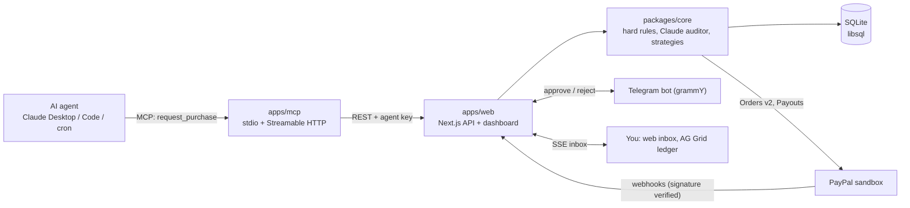

# Reins

**Give every AI agent a PayPal wallet with a leash.**

Agents can pay, but it is all or nothing. Reins gives each agent its own key and a versioned mandate (monthly cap, auto-approve limit, per-purchase cap, allowed merchants). Agents connect over MCP and call `request_purchase`. Hard rules run first, then a Claude auditor reviews purpose fit and risk and returns AUTO_APPROVE, ASK_HUMAN or DENY. Small, in-policy purchases are paid at once through PayPal Orders v2; bigger ones wait for one tap on a web inbox or Telegram card; manipulated ones (say, a web page telling the agent to buy a $450 logo) are blocked before any money moves. Every decision lands in an AG Grid ledger with a full audit trail.

Built for the PayPal AI Hackathon 2026. Targets: Best Use of Agentic Commerce, AG Grid, Render. (APIMatic is not claimed: the Context Plugin has not been used on this repo yet.)

Note: the ledger uses AG Grid Enterprise in trial mode (no licence key; set `NEXT_PUBLIC_AG_GRID_LICENSE_KEY` to remove the trial watermark). A public deploy may show the watermark.

- Demo video: _YouTube link (to add after upload)_. Under 3 minutes; recorded locally on a scratch database with the fake PayPal client, the offline stand-in for the Claude auditor and Telegram off (the Telegram card in the video is the real bot's card text, shown as a panel). Re-record with `node scripts/demo/record-video.mjs` (script and narration: `scripts/demo/`).
- Live demo: https://reins-web.onrender.com _(to confirm after deploy; free instances sleep, first load takes about a minute)_
- Devpost text: [docs/submission/devpost.md](docs/submission/devpost.md)

## How it works



Decision flow for `request_purchase`:

1. Hard rules in code: monthly cap, per-purchase cap, allow and block lists. A failure is DENY, no model involved.
2. Claude audits purpose fit and risk (structured verdict). Code bounds it: DENY on a model DENY or risk >= 8; AUTO_APPROVE only if risk <= 3 and the amount is within the auto-approve limit. Auditor timeout or error means ASK_HUMAN, never auto-pay. Without `ANTHROPIC_API_KEY` a deterministic mock auditor runs.
3. AUTO_APPROVE pays now. ASK_HUMAN returns `pending_human` and sends a web inbox item and a Telegram card (Approve, Approve + always allow this merchant, Reject). The agent polls `get_request_status` and gets the receipt.

MCP tools: `get_mandate` (includes the agent's status: active or paused), `request_purchase`, `get_request_status`, `list_transactions`.

## API

MCP tools (what an agent sees; each calls the REST API below with the agent's `Authorization: Bearer rk_live_...` key):

| MCP tool | REST call | Purpose |
|---|---|---|
| `get_mandate` | `GET /api/mandate` | Current limits, allowed and blocked merchants, agent status (active or paused) |
| `request_purchase` | `POST /api/requests` | Ask to buy: merchant, amount, item, reason, `client_request_id` (idempotent). Returns `paid`, `pending_human` or `denied` with a receipt or reason |
| `get_request_status` | `GET /api/requests/:id` | Poll a pending request until it is paid, denied or expired |
| `list_transactions` | `GET /api/transactions` | The agent's own recent requests |

REST endpoints used by the dashboard (admin routes need `REINS_ADMIN_TOKEN` only when it is set; the public demo is open):

| Area | Endpoint | Auth |
|---|---|---|
| Agent | `GET /api/mandate`, `POST /api/requests`, `GET /api/requests/:id`, `POST /api/requests/:id/answer`, `GET /api/transactions` | agent key |
| Overview | `GET /api/overview?period=month\|30d`, `GET /api/overview/summary` | admin |
| Agents | `GET/POST /api/agents`, `POST /api/agents/:id/pause`, `.../resume`, `.../rotate-key`, `GET .../events` | admin |
| Mandates | `GET/POST /api/agents/:id/mandates`, `POST /api/mandates/suggest-categories` | admin |
| Inbox | `GET /api/inbox`, `POST /api/requests/:id/decision`, `POST /api/requests/:id/ask`, `GET /api/events` (SSE) | admin |
| Ledger | `GET /api/ledger`, `GET /api/ledger/:id`, `GET /api/ledger/:id/detail`, `POST /api/requests/:id/pause-agent`, `.../mark-expected`, `GET /api/receipts/:id` | admin |
| Setup | `GET /api/workspace`, `POST /api/workspace/mode`, `POST /api/paypal/connect`, `POST /api/paypal/vault/start`, `.../vault/complete`, `POST /api/telegram/link` | admin |
| Reconcile | `POST /api/reconcile`, `POST /api/cron/reconcile` | admin, cron secret |
| Webhooks | `POST /api/webhooks/paypal` (signature verified), `POST /api/telegram/webhook` (secret token), `GET /api/health` | public |

Dashboard deep links: `/ledger/R-0143` (or `/ledger?r=R-0143&drawer=1`) opens that request's detail drawer, `/approvals/R-0143` opens the approvals inbox on that request, `/agents/research-scout` (name slug or agent id) opens that agent's mandate. An unknown id shows a notice instead of a blank page, and unknown routes get a branded 404.

Agent controls: pause an agent (web, the S6 drawer or the Telegram card's "Pause this agent"), and every request it sends is denied by the "agent paused" hard rule before the auditor or PayPal runs; regenerate a key (old key stops working at once, the new one is shown once). Both are logged in `agent_events`.

PayPal APIs used (sandbox): `POST /v1/oauth2/token`, Orders v2 (`POST /v2/checkout/orders` with `PayPal-Request-Id`, `GET` and `POST .../capture`, `store_in_vault` for saving the buyer's PayPal, then `vault_id` reorders), Payouts (`POST /v1/payments/payouts`, treasury mode), webhooks (`POST /v1/notifications/verify-webhook-signature`), Transaction Search (`GET /v1/reporting/transactions`, reconciliation).

## Quickstart (no credentials)

```bash
pnpm install
cp .env.example .env
# in .env set PAYPAL_ENV=fake  (in-process fake PayPal, mock auditor, no network)
pnpm seed                   # 3 agents, 24 requests: "This month $117.97 of $410" on a fresh seed (the video shows $176.97 after approving the $59 Statista request)
pnpm dev:web                # http://localhost:3000
pnpm test                   # 224 tests
```

Open `/agents`, create an agent and copy its `rk_live_...` key (shown once; seeded `rk_demo_` keys are not usable). Approvals work from `/inbox` without Telegram.

## Connect your own Claude (MCP)

Claude Code (stdio, from the repo root):

```bash
cp .mcp.json.example .mcp.json      # local file, do not commit
export REINS_API_KEY=rk_live_...
claude mcp list
```

Claude Code against a hosted server (Streamable HTTP):

```bash
claude mcp add --transport http reins https://reins-mcp.onrender.com/mcp --header "Authorization: Bearer rk_live_..."
```

Claude Desktop (`claude_desktop_config.json`):

```json
{
  "mcpServers": {
    "reins": {
      "command": "npx",
      "args": ["-y", "tsx", "/ABSOLUTE/PATH/TO/reins/apps/mcp/src/stdio.ts"],
      "env": { "REINS_API_URL": "http://localhost:3000", "REINS_API_KEY": "rk_live_..." }
    }
  }
}
```

The Agents screen's "MCP connection" card shows this same clone-based stdio config (replace `/ABSOLUTE/PATH/TO/reins` with your checkout; `REINS_URL` and `REINS_API_URL` both work). `@reins/mcp` is not published to npm, so there is no short `npx -y @reins/mcp` form.

Demo prompts and Channel3 product search setup: [agents/README.md](agents/README.md).

## Security notes

- Agent keys are stored only as SHA-256 hashes and shown once (also after "Regenerate key", which replaces the hash so the old key gets 401 immediately).
- `request_purchase` is idempotent per agent and `client_request_id`; PayPal calls carry `PayPal-Request-Id`.
- Agent-written fields are untrusted: the auditor prompt treats them as data, and hard rules hold even if the model is fooled.
- No PayPal credentials or `vault_id` are sent to the LLM; rejection reasons do not echo the raw prompt text.
- PayPal webhooks are verified with `verify-webhook-signature`; Telegram webhooks with a secret token.
- Secrets live in environment variables (Render env vars in production), never in the repo. Logs avoid secrets and emails.
- The public demo is deliberately open (`REINS_PUBLIC_DEMO=1`, no admin token) and sandbox-only. Set `REINS_ADMIN_TOKEN` for a private deployment.

## Status

Plan flow B runs end to end (auto-paid, human-approved on web or Telegram, denied), covered by `tests/integration/checkpoint.test.ts`. Sandbox spikes (vault auto-pay, payouts, webhook signatures) are in `docs/spikes/`. Also built: "Also allow this merchant" on approval (new mandate version), receipts (`/receipts/:id`), unusual-pattern flags (`REINS_QUIET_HOURS`, `REINS_TIMEZONE`), a DevOps cron demo agent, AI summaries, one-click "Tighten mandate".

Dashboard details: a sidebar agents list with live cap use and a paused marker; a Cmd/Ctrl+K palette over pages, agents and requests; Agents KPI tile on the ledger; a mandate version dropdown (open an old version to restore it); an approval card with the mandate check (for example 3 of 4 pass), the auditor's risk and the budget left after approving, plus deny reasons and `A`/`D` keys; Pending and Decided tabs; a request drawer with the decision timeline, a hard-rule table, risk gauge, EN/KO reason and the raw MCP request (key redacted); a phone-width (390 px) layout with a card-style ledger. The weekly summary is a labelled template unless `ANTHROPIC_API_KEY` is set. The drawer's "Model" line (tokens, latency) is real only for live Claude runs; in the seed it is scripted demo data.

## Prior art

Skyfire and card-network agent tokens address agent payments too. Reins differs in three ways: PayPal-native (no separate wallet or crypto), open-source MCP server you connect in minutes, and a human approval UX with an AI auditor that explains its decision.

| | Reins | Skyfire / card-network agent tokens | Bare PayPal Agent Toolkit |
|---|---|---|---|
| Per-agent mandate (limits, merchants, window) | Yes, versioned per agent | Per-agent wallet or token | No, one set of API credentials |
| Hard rules enforced in code, before any money moves | Yes, deterministic | Limits on the token or wallet | No |
| AI audit with a written explanation | Yes, Claude, advisory on top of the rules | No | No |
| Human one-tap approval (Telegram / web) | Yes | Varies | No |
| Open source, MCP, PayPal-native | Yes, MIT-style repo, MCP server | Mostly closed, separate wallet or rails | Open source, PayPal-native |

**Works with the PayPal Agent Toolkit.** Reins is the policy and approval layer in front of PayPal Orders v2: an agent asks Reins, and Reins decides, then creates the sandbox order itself. Composing Reins with the Agent Toolkit's own tools (letting the Toolkit call Reins before it pays) is not implemented; today agents connect through Reins' MCP server instead of the Toolkit.

## Develop

```bash
pnpm install
cp .env.example .env        # PAYPAL_ENV=fake runs without any keys
# apps/web reads the root .env through `node --env-file-if-exists=../../.env` (see apps/web/package.json),
# so keep a single .env at the repo root. Fill it with scripts/setup-env.sh (never echoes secrets).
pnpm test                   # vitest: unit + tests/integration
pnpm typecheck && pnpm lint
pnpm dev:web                # http://localhost:3000 (API under /api)
pnpm mcp:stdio              # MCP over stdio (REINS_API_KEY=rk_live_...)
pnpm mcp:http               # MCP over Streamable HTTP on :3333/mcp
pnpm tokens                 # regenerate design tokens CSS
pnpm reconcile              # M11 Transaction Search reconciliation on the local DB, counts only (deployed: `POST /api/cron/reconcile` with the cron secret, run by hand)
pnpm telegram:check         # #9 real bot check: getMe, finds your /start, sends one demo card
```

Screens: `/overview` (S7 home: month spend vs caps, decision mix, category donut, recent decisions, AI weekly summary), `/setup` (S1 connect PayPal, payment mode, Telegram), `/agents` (S2 mandates), `/inbox` (S5 approvals with Ask agent),
`/ledger` (S4 AG Grid + AG Charts). Telegram uses long polling when `PUBLIC_BASE_URL` is not https, so approval buttons
work locally without a tunnel. Demo walkthrough: [docs/demo-checkpoint.md](docs/demo-checkpoint.md).

Sandbox spikes (need keys in `.env`, write results to `docs/spikes/`):

```bash
pnpm spike scripts/spikes/d2-payment.ts           # #33 #27 #28 order/capture + vault_id
pnpm spike scripts/spikes/payee-email.ts          # #29 payee.email_address
pnpm spike scripts/spikes/d3-payouts-webhooks.ts  # #34 payouts + webhook verify
pnpm spike scripts/spikes/channel3.ts             # #31 Channel3 search
```

Layout: `apps/web` (Next.js 15 UI + REST + webhooks), `apps/mcp` (MCP server), `apps/bot` (grammY handlers), `packages/core` (policy, PayPal client, payment strategies), `packages/db` (Drizzle, SQLite/libsql locally).

## Deploy

Render Blueprint (`render.yaml`) on the free plan: two web services (dashboard/API and MCP HTTP), SQLite in `/tmp` (no disk), demo data re-seeded on every boot. Free instances sleep after ~15 min idle (wake in ~1 min) and sleeping resets the demo state. There are no cron jobs on Render; run the DevOps agent and reconcile by hand (commands in the `render.yaml` header).
Step-by-step (Korean), env vars, PayPal/Telegram webhook URLs and smoke checks: [docs/deploy.md](docs/deploy.md).

## Demo data

```bash
pnpm seed                        # 3 agents, 3 mandates, 24 requests in apps/web/.local/reins.db (what `pnpm dev:web` uses)
pnpm seed -- --db ./scratch.db   # another file; point the app at it with DATABASE_URL=file:./scratch.db
pnpm seed -- --force             # also run against a DB that has real data (only the seed rows are replaced)
pnpm seed -- --if-empty          # every boot (Render start command, /tmp starts empty): seed only if the DB has no agents, never forces
```

Matches the plan's flow C on a fresh seed: "This month $117.97 of $410 across 3 agents" (limits $150 / $100 / $160), with auto-paid, human-approved,
human-rejected, hard-rule-blocked (the $450 fiverr.com injection, R-0143), a declined card, an expired approval and 1 pending approval (R-0142):
24 requests this month, Auto 19 · Human 4 · Blocked 1, and a current ISO week of 6 purchases for $84.98. (The demo video shows $176.97 of $410 because the $59 Statista request is approved live on camera; the seed alone reads $117.97.) Research Scout has mandate versions v1, v2, v3.
No PayPal or Claude calls (fake `FAKE-ORDER-*` / `FAKE-CAPTURE-*` ids; the auditor verdicts, tokens and latencies are scripted demo data). Seed agents use `rk_demo_` keys that are never stored or printed, so create
a fresh agent for live MCP runs. Re-running replaces only seed rows and refuses a DB with other data unless `--force`. Pending approvals
expire after `REINS_APPROVAL_TTL_MINUTES` (default 30), so re-seed right before a demo.

## Demo agent A (Claude Desktop / Claude Code)

Config snippets that expose the 4 Reins MCP tools (plus Channel3 product search) to Claude Desktop (`agents/claude_desktop_config.json`) and Claude Code (`.mcp.json.example`). Setup steps and demo prompts: [agents/README.md](agents/README.md).

## Demo agent B (DevOps agent)

`pnpm agent:devops` checks `agents/devops/infra-costs.json`, pays bills due in the next 3 days that fit the auto-approve limit through
the Reins MCP stdio server, and leaves bigger ones for you (`--ask` requests them for approval, `--dry-run` only reports). Idempotency
keys are per bill and month, so a second run the same day pays nothing. Details: [agents/README.md](agents/README.md#demo-agent-b-devops-agent).

## License

MIT
